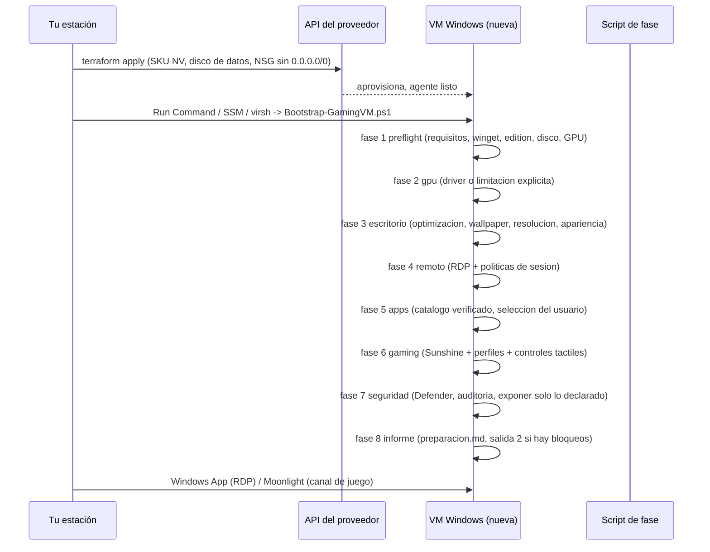

# 01 · Arquitectura

## La idea en una frase

Una **VM Windows real** en un proveedor que tú pagas, accesible con **Windows App**
(protocolo RDP), con un instalador de aplicaciones **verificado y opcional**, un canal
alternativo **Sunshine/Moonlight** para el juego con controles táctiles **solo si la
maquina lo puede sostener**, y un **informe honesto** de que se ha aplicado.

No hay cliente propio, no hay App Store propia, no hay "nube de gaming" propia: el proyecto
es la **capa de preparación reproducible** de una VM de Windows.

## Cuatro capas, deliberadamente separadas

| Capa | Donde vive | Que decide | Que NO puede hacer |
| --- | --- | --- | --- |
| **Infraestructura** | `infra/{azure,aws,kvm}` (Terraform) | SKU, región, discos, red, NSG/SG, imagen | Instalar apps, ajustar el SO, tocar el registro |
| **Sistema operativo** | `scripts/win/Bootstrap-GamingVM.ps1` (8 fases) | RDP, apps, optimización, seguridad, canal de juego, informe | Crear recursos facturables, cambiar tu licencia |
| **Cliente** | `scripts/client/*`, Windows App, Moonlight | Resolución, calidad, teclado táctil, túnel, overlay | Modificar la VM, redirigir lo que el protocolo no soporta |
| **Datos** | `D:\WinGamingVM` + disco de datos gestionado | Juegos, perfiles, informes, backups | Vivir en el disco temporal del SKU (se pierde) |

Separar infraestructura del SO es lo que hace que esto sea reproducible: `terraform destroy`
no borra tus decisiones de configuración, y el bootstrap se puede volver a lanzar fase a
fase contra una VM nueva sin tocar la red.

## Flujo de una instalación completa



Cada fase escribe en `state\fases.json` antes y después. Si algo revienta en la fase 5,
las fases 1-4 **no** se repiten: `-Reanudar` retoma donde estaba. Es el motivo por el que el
bootstrap puede correr dentro de un `az vm run-command` con timeout corto.

## Por qué RDP es la puerta y Sunshine es un extra

- **Windows App habla RDP** (y solo RDP/UDP/AVC/H.264/HEVC según el cliente). Es la vía
  soportada, con NLA, redirección de portapapeles, audio y sesiones múltiples.
- RDP **no redirige mandos** ni dibuja overlays táctiles en Android: el mando virtual y el
  overlay táctil son cosa del **cliente de streaming**, no del protocolo de escritorio.
- Por eso existe el canal de juego: Sunshine en la VM + Moonlight en el dispositivo, que sí
  tiene overlay táctil configurable, y que **necesita una GPU con codificador por hardware**.

El proyecto deja que elijas en `config/vm.json` (`gaming.channel`: `rdp` | `moonlight` | `both`)
y **no finge lo que no puede**: con `rdp`, el informe dice "sin overlays táctiles ni mando
virtual"; sin GPU, la fase de gaming termina en `desactivado-sin-gpu`.

## Mapa del repositorio

```text
README.md                    guia completa (empieza aqui)
config/                      vm.json (tuyo, ignorado) + schema + limites del proveedor
  vm.schema.json             validacion con additionalProperties:false
  provider-limits.json       vCPU/RAM/discos REALES por SKU (no valores inventados)
  windows-editions.json      que admite cada edicion (Store, GameDVR, DX12U, multi-sesion)
  remote-session.json        politicas base de sesion + presets del cliente .rdp
  gaming-presets.json        bitrate/resolucion/fps segun red + formula de consumo
  resolutions.json           resoluciones validas y escalado
apps/                        catalogo de apps (JSON Schemas + fuentes oficiales + selecciones)
  catalog.json               30 apps con winget id, firmante esperado, sha256 cuando existe
  sources.json               lista blanca de hosts de descarga
  selections/*.json          minimal / utilities / gaming / full
gaming/                      perfiles de control, layouts tactiles, antitrampas, ajustes
  schemas/*.json             contrato de perfil y de layout (validado en CI)
  profiles/*.json            7 perfiles con requisitos + antichat + que hace cada canal
  touch/layouts/*.json       5 layouts con geometria normalizada (para reproducir en el cliente)
  steam|ajustes|antitrampas  documentacion especifica
infra/                       Terraform por proveedor (azure, aws, kvm)
scripts/
  win/                       Bootstrap + 8 fases + modulo GamingVM + medicion + readiness
  win/Modules/GamingVM       logging, checkpoints, config, firma, winget, registry backup
  deploy/                    automatizacion desde tu estacion (az run-command, SSM, backups)
  client/                    Windows App, tunel SSH, diagnostico del canal, Android
  linux/                     KVM: diagnosticos GPU + creacion con virt-install
  validate/                  validador del repo, comprobacion de enlaces, notas de release
tests/                       pruebas del validador y de fixtures (sin red, sin VM)
docs/                        esta documentacion
.github/workflows/           validate.yml, release.yml, tf-lint.yml, windows-scripts.yml
```

## Decisiones de diseño y su motivo

| Decision | Alternativa descartada | Motivo |
| --- | --- | --- |
| Bootstrap en 8 fases idempotentes | un script monolítico | un reinicio o un fallo de red a mitad no debe obligar a empezar de cero |
| Registro tocado vía `Set-GvmRegistryValue` con `.reg` de respaldo | escribir claves a pelo | poder revertir sin reinstalar la VM (`Remove-GamingVM.ps1`) |
| winget como instalador, catálogo aparte | descargar y ejecutar instaladores | winget conoce las fuentes, los acuerdos y la desinstalación; el catálogo aporta la verificación |
| Verificación por firmante + SHA cuando está | "confía en la URL" | la firma es lo único que puedes comprobar en la máquina objetivo |
| Sunshine como canal de juego, opcional y con GPU obligatoria | prometer streaming en cualquier VM | sin codificador por hardware la experiencia es mala y el proyecto no la oculta |
| El cliente Moonlight configura el overlay | generar perfiles importables desde el host | Moonlight guarda en `SharedPreferences`: no hay API de importación; documentamos los pasos |
| `additionalProperties: false` en todos los esquemas | JSON libre | un campo mal escrito silenciosamente es peor que un error de validación |
| Documento de límites por proveedor | "debería funcionar en cualquier nube" | los límites (licencia, Store, antichat, GPU virtual) son el 80 % de las sorpresas |

## Qué se ejecuta donde (resumen operativo)

**Tu estación:** `validate.py`, Terraform, `scripts/deploy/*`, `scripts/client/*`.
**La VM (como Sistema):** `Bootstrap-GamingVM.ps1` y las 8 fases; después
`Test-GamingReadiness.ps1` y `Get-SystemMetrics.ps1` cuando quieras medir.
**El dispositivo cliente:** Windows App o Moonlight; sus ajustes **no** se pueden fijar en
remoto, solo documentar (por eso existe `gaming/touch/README.md`).

## Escalado y multi-usuario: lo que este proyecto no es

- No es un host multi-sesión: Windows Server permite sesiones administrativas concurrentes
  (2 por licencia, más CALs si quieres más) y Windows 11 no; el proyecto configura **una
  sesión de consola** porque el canal de juego la necesita en exclusiva (Sunshine comparte
  la pantalla de la consola).
- No reparte una GPU entre varios jugadores: las series NV usan GPU *compartida virtual* y
  cada VM ve su fracción; el aislamiento es el del hypervisor, no un software nuestro.
- No es un servicio público: si piensas dar acceso a terceros, necesitas otra arquitectura
  (identidades, aprovisionamiento por usuario, límites de gasto, registro de sesiones).
