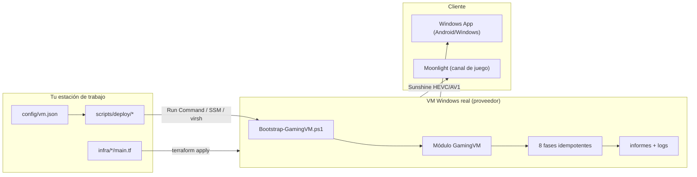

# Documentación

Guía completa del proyecto en español. Cada documento dice **qué está automatizado, qué es
manual y qué no es posible**: si un límite aplica a tu combinación de proveedor, edición de
Windows y cliente, está escrito aquí y también en la salida de los scripts.

| # | Documento | Léelo si… |
| --- | --- | --- |
| [01 · Arquitectura](01-arquitectura.md) | quieres entender las cuatro capas (VM, SO, apps, canal remoto) y por qué están separadas |
| [02 · Proveedores y límites](02-proveedores-y-limites.md) | vas a elegir Azure / AWS / KVM y quieres saber qué **no** te da cada uno |
| [03 · Preparación de la VM](03-preparacion-vm.md) | vas a ejecutar el bootstrap fase a fase, o se ha roto a mitad |
| [04 · Aplicaciones](04-aplicaciones.md) | quieres añadir/quitar apps del catálogo y entender la verificación |
| [05 · Acceso remoto](05-acceso-remoto.md) | configuras Windows App, el túnel y la calidad de sesión |
| [06 · Límites de Windows App](06-limitaciones-windows-app.md) | juegas desde Android y quieres saber qué se puede y qué no |
| [07 · Gaming y antitrampas](07-gaming-y-antitrampas.md) | antes de instalar un juego concreto |
| [08 · Monitoreo de rendimiento](08-monitoreo-rendimiento.md) | necesitas medir latencia, CPU/GPU/disco y estabilidad |
| [09 · Seguridad](09-seguridad.md) | vas a exponer un puerto, o compartes el repo con alguien |
| [10 · Requisitos](10-requisitos.md) | checklist de hardware, software, licencias y cuenta que paga |
| [11 · Prueba de aceptación](11-prueba-de-aceptacion.md) | quieres verificar que tu despliegue funciona de verdad |
| [12 · Ideas evaluadas](12-ideas-evaluadas.md) | te preguntas por qué algo "obvio" no está hecho |

## Cómo está organizado el repositorio



## Reglas que sostienen todo lo anterior

1. **Nada simulado.** Un componente que no se pueda configurar de verdad no se configura:
   se documenta como límite y los scripts lo reportan (`pendiente-manual`,
   `desactivado-sin-gpu`, `bloqueada-en-vm`, `rechazada-fuente`).
2. **Las apps son opcionales.** Un catálogo no es una lista de instalación: decide
   `apps/selections/*.json` + `config/vm.json`.
3. **Ninguna promesa de rendimiento.** El fps lo determinan SKU, driver, red y juego.
4. **Credenciales fuera del repo.** Contraseñas por entorno o gestor; `.gitignore` cubre
   `config/vm.json`, `*.tfvars`, `*.rdp`, claves y `.pfx`.
5. **El acceso remoto se asegura antes de abrirse.** Sin `allowedCidrs` no hay regla de
   entrada, ni en Terraform ni en el firewall de la VM.

## Si vienes a montar esto hoy

```bash
# 1) Validar que tu configuración es coherente (no toca ninguna VM)
pip install -r scripts/validate/requirements.txt
python scripts/validate/validate.py --verbose

# 2) Crear la VM
cd infra/azure && terraform init && terraform plan -out=tf.plan && terraform apply tf.plan

# 3) Preparar Windows dentro de la VM (8 fases, reanudables)
pwsh scripts/deploy/azure-deploy.ps1 -ResourceGroup rg-... -Name ... -ConfigFile config/vm.json

# 4) Conectar con Windows App y comprobar con la prueba de aceptación
```
